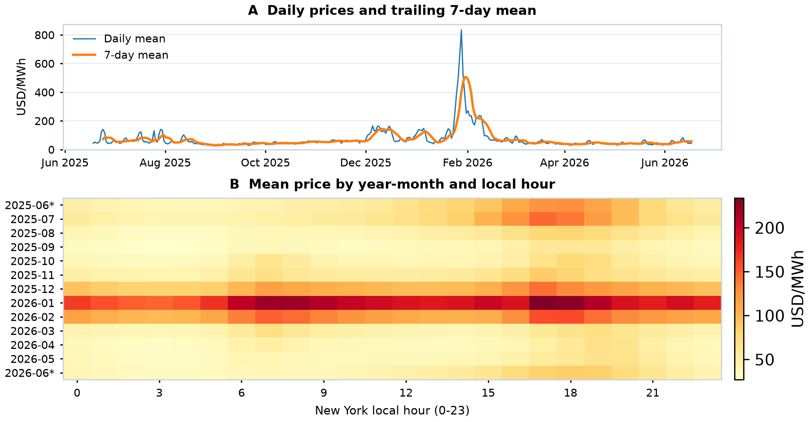

# NYISO Day-Ahead Electricity Price Analysis

How do day-ahead electricity prices vary over time, and when are unusually high prices concentrated?

This Python project examines hourly electricity prices for New York City. It combines CSV ingestion, explicit type conversion, daylight-saving-aware timestamps, custom analysis functions, and static visualizations.

## Data

The input is a NYISO OASIS day-ahead market zonal locational-based marginal price (LBMP) export. The local input file is named `nyiso_day_ahead.csv`. See the [NYISO market data portal](https://www.nyiso.com/energy-market-operational-data) for the data provider.

- Zone: N.Y.C.; PTID: 61761.
- Coverage: 2025-06-18 through 2026-06-17, inclusive, in New York local time.
- Observations: 8,760 hourly records.
- Price unit: USD/MWh.
- Boundary months are partial: June 2025 contains 13 days; June 2026 contains 17 days.

## Approach

1. Map the original column names to readable names and explicitly parse timestamps and numeric fields.
2. Resolve EDT/EST labels to UTC, check unique hourly instants and continuity, and group prices by New York local time. Both observations in the repeated fall-back hour are retained.
3. Use custom functions to validate the data and calculate mean, median, the 95th percentile, and maximum price. Invalid input raises an error rather than being silently discarded; valid price spikes are retained without trimming or imputation.
4. Plot daily mean prices with a trailing average of seven daily means, and a year-month-by-local-hour heatmap. Year-month keys keep the two June periods distinct.

Price summaries use unweighted hourly observations, not load-weighted prices. The rolling curve gives equal weight to seven daily means and remains undefined for the first six days. High-price hours are defined as prices strictly above the full-sample 95th percentile, calculated using linear interpolation.

## Results

| Statistic | Price (USD/MWh) |
| --- | ---: |
| Mean | 72.419 |
| Median | 50.345 |
| 95th percentile | 189.092 |
| Maximum | 1,058.270 |

There are 438 high-price hours, or 5.0% of the sample. Of these, 364 hours (83.1%) occur in January and February 2026. The heatmap also shows higher mean prices in late-afternoon and evening hours in several months.

The source checks found no missing values, exact duplicate rows, repeated UTC instants, or hourly UTC gaps. All 8,760 observations were retained.

These findings describe this rolling year; they do not establish causal relationships or forecasting performance.



[View the two-page code and output sample](NYISO_UChicago_Programming_Supplement_With_Intro_Comments.pdf)

## Run locally

Use Python 3.11 or later. The reference environment is Python 3.12.14 on Windows; the six direct dependency versions are pinned in `requirements.txt`.

Download the project files into one folder. Keep `nyiso_day_ahead.csv` next to `nyiso_programming_supplement.py`. From that folder, run:

```bash
python -m pip install -r requirements.txt
python nyiso_programming_supplement.py
```

To use another CSV or output folder:

```bash
python nyiso_programming_supplement.py "path/to/data.csv" --out-dir "results"
```

Custom inputs must retain the original NYISO export headers, the `YYYY/MM/DD HH:MM` date format, and EDT/EST labels, and contain a single zone with a continuous hourly UTC timeline.

By default, the script saves these files beside itself:

| File | Contents |
| --- | --- |
| `NYISO_UChicago_Programming_Supplement.pdf` | Generated two-page code and output sample |
| `nyiso_price_patterns.png` | Static two-panel figure |
| `nyiso_daily_prices.csv` | Daily means and seven-day moving averages |
| `nyiso_month_hour_means.csv` | Mean prices by year-month and local hour |
| `nyiso_audit_results.json` | Summary statistics and source checks |

The generated PDF uses a shorter filename than the linked sample above. Close an existing output PDF before rerunning if a viewer has locked it. The script uses Consolas when available and otherwise falls back to Courier; no font files need to be included.
